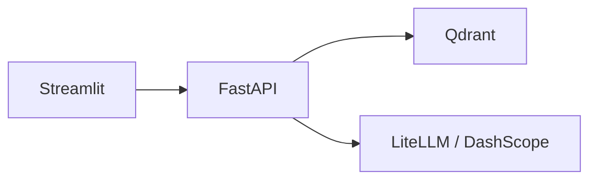

# 项目笔记

## 1. FastAPI

FastAPI 是基于 Starlette 的 Python Web 框架：用类型注解描述请求/响应，自动生成 OpenAPI。本仓库后端是独立服务，不和 Streamlit 跑在同一个进程里。

本项目：

- 入口 `backend/src/main.py`：组装 CORS、路由、lifespan，再用 uvicorn 监听。云平台的 `PORT` 覆盖本地端口。
- `api/` 只做 HTTP：路由、schema、依赖注入。业务在 `app/services/`，向量库和模型在 `infra/`。
- 问答走 SSE（`text/event-stream`），每段是 `data: ...`。探活是 `GET /health`，不检查知识库是否已加载。

## 2. Streamlit

Streamlit 用脚本从上到下渲染页面：改输入或点按钮会整页再跑一遍。没有 Next.js 那种前后端同仓路由。

本项目：

- 入口 `frontend/src/main.py`：页头、侧边栏知识库、主区聊天。
- 前端不保存对话正文。展示历史向后端 `GET /chat/messages` 拉取；流式结束后设 `_needs_rerun`，再对一次账，才能带上引用面板。
- `BACKEND_API_URL` 指向后端的 `/api/v1.0`。本地默认 `http://localhost:8000/api/v1.0`。

## 3. LlamaIndex 与 Qdrant

LlamaIndex 负责把原文切成块、写成向量节点。Qdrant 存向量和 payload，检索时返回最相近的若干块。

本项目：

- 切分用 `SentenceSplitter`（`infra/rag/chunker.py`）。侧边栏改的分块大小/重叠只作用于**之后**入库的内容。
- 向量化走 DashScope Embedding，请求维度必须和 Qdrant collection 一致。
- 生产用 `QDRANT_MODE=cloud`。`memory` 只给测试。collection 名默认 `chatter`。
- 文件用来源文件名当 `source_id`，网页用规范化 URL，数据库用脱敏连接串 + SQL。同一 ID 再导入先删旧块再写，避免重复堆叠。

问答时：用当前问题检索 `top_k` 块 → 编成 `[1][2]…` 写进 system 消息 → 再把近期对话和本轮用户输入交给模型。

## 4. LiteLLM 与短期记忆

LiteLLM 用统一接口调各家模型。本仓库只注册了若干 DashScope 短名（如 `qwen3.7-max`），不接受任意模型字符串。

对话有两份进程内字典，都不是数据库：

- **展示历史**（`infra/chat/history.py`）：完整问答，含引用，给前端渲染。
- **短期记忆**（`infra/chat/memory.py`）：只保留最近若干条 user/assistant，喂给下一轮模型。上限 `MAX_HISTORY_MESSAGES`。

重启后端进程后两份都空。这是 Demo 边界，不是漏做的「以后再接 Redis」。

## 5. 引用校验

检索到的块不等于回答真正用过的证据。若把检索列表原样展示，用户会以为每条都支撑了结论。

做法：

1. 检索块统一编号写入 prompt，要求模型在用到的句子后写 `[n]`。
2. 流式结束后用正则从正文抽出编号（半角 `[1]`、全角 `【1】` / `［1］`）。
3. 命中范围内的标 `used=true`，检索到但没出现的标 `used=false`。前端分成两组展示。

这是生成后核对，不是模型内部的忠实度保证。编造未检索编号只会打日志，不会据此再调一次模型。

## 6. 导入边界

文件、网页、数据库都收成同一套 Document，再切块入库。

- **上传：** 限制个数和体积；只接受 PDF / Markdown / TXT。
- **网页：** 自抓 HTML（补 UA、修中文编码），只允许公网 `http/https`，拒绝本机/私网，不跟随跳转；过滤「请开启 JavaScript」一类壳页面。
- **数据库：** 只执行单条 `SELECT`，限制行数和单行长度。连接串在展示用的 `source_uri` 里脱敏。

这些限制是为了 Demo 不被当成任意 SSRF / 任意 SQL 执行器，不是完整的多租户安全模型。页面没有登录，能打开 UI 的人共用同一份知识库。

## 7. GitHub Actions

`.github/workflows/ci.yml` 在 `master` / `main` 的 push 和 PR 上，分别对 `backend/`、`frontend/` 执行 `uv sync --frozen`、Ruff、Pytest。

CI 里的 Key 和 Qdrant 都是占位，不打真实模型和云向量库。质量检查和线上数据必须分开。

## 8. Render

Render 把 Git 仓库跑成 Web Service。本项目前后端各一个服务：后端提供 API，前端是 Streamlit，用环境变量指向后端。

知识在 Qdrant Cloud，不随 Render 容器重启丢失。对话在 API 进程内存里，重启即空。CORS 当前允许任意来源，只适合这个 Demo。
